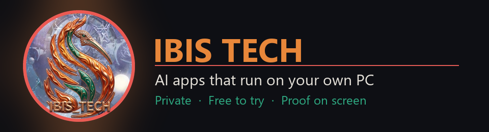

# Ibis Tech

**Most AI apps want your files on their servers. I wanted the opposite.**

I'm Joe (Joseph Carl Thomas), the architect behind Ibis Tech. Every Ibis app runs on your own Windows PC, works with the
AI model *you* pick, and shows its proof on screen instead of asking you to trust it. Each one is tested on a fresh
Windows PC before it goes out.

**The apps are free to try on itch.io.** That's also where you can support the work if one helps you.

---

## 🕷️ Ibis Spider: a free AI that reads your own books and answers with the page number

- **Answers from YOUR library**, naming the book and the page so you can check it. If the answer isn't in your books, it
  says so instead of making something up.
- **Reads what you give it:** PDF, EPUB, Word, Excel, PowerPoint, web pages, even scanned pages. It sorts everything onto
  shelves for you.
- **Writes with you:** stories, books, scripts, comics, ads, songs, cards, how-to guides and contracts, with a critic
  checking the work.
- **Talks and learns:** speak to it and your personas answer out loud. Tell it when it's right or wrong, and a built-in
  exam shows whether it really learned.
- **Private:** no account, no ads, no tracking. Use a free local AI through Ollama or LM Studio so nothing leaves your
  PC, or your own cloud key. Keys are locked with Windows' own encryption.

**→ [Try Ibis Spider free on itch.io](https://ibisflame.itch.io/ibis-spider)**

---

## 📦 Ibis Quantized Containers (IQC): run AI models and apps in locked boxes on Windows

- **Locked boxes:** apps run with hard limits on memory, CPU and processes, and can't write outside their box. One
  button (🔬 PROVE) shows it live on your PC. No Docker, no Linux, no Python to install.
- **Shrinks AI models** to fit your graphics card. It turns Hugging Face models (Llama, Qwen, Granite, Gemma and more)
  into GGUF files for Ollama, LM Studio and llama.cpp, checked byte for byte against llama.cpp's own converter.
- **🏁 Speed test:** runs the same model through every engine on your PC and shows which one is really fastest.
  Measured, not claimed.
- **🔐 Keys stay safe:** every build is scanned for passwords and keys before it can ship in a box. Keys you pass in are
  sealed with Windows' own encryption.
- **Honest about limits:** without admin rights, Windows can't stop a boxed program from *reading* your files or using
  the network. IQC tells you so in the app.

**→ [Try IQC free on itch.io](https://ibisflame.itch.io/ibis-quantized-containers)**

---

## 🐍 MEDUSA: a free creative suite that runs on your own PC

- **Edit on any Windows PC:** a video editor for shorts and videos (9:16, 16:9, 1:1, 4:5) with titles, captions, music
  and voice tracks; an audio editor that measures every change before and after; a photo editor; 32 built-in fonts for
  lettering and comic pages.
- **Make with AI on your own graphics card:** pictures, video (Wan 2.2) and voices (Qwen3-TTS) with the models *you*
  choose. This needs an NVIDIA card with 6 GB or more; a one-click setup for those parts is the next update.
- **Safe by design:** adults only, a real person's face or voice needs their consent, and what she makes with AI is
  labelled AI-generated.
- **Updates herself:** she asks once, checks every update's signature and fingerprint, and puts your version back if a
  new one doesn't start. Your projects are never touched.

**→ [Try MEDUSA free on itch.io](https://ibisflame.itch.io/medusa)**

---

## 🧑‍💻 IBIS-CODER: a free AI coder you can watch, on your own PC

- **A real code editor:** Monaco, the editor inside VS Code, built in and working offline, with find across the project,
  errors marked as you type, and a terminal.
- **An AI coder on the model *you* pick:** ask it about your code, or let it do the work. It reads, edits, runs the tests
  and fixes, and you watch every step. Every change can be undone.
- **Measured, not claimed:** on a 6 GB laptop, ministral-3 fixed 9 of 9 real test tasks and granite4.1:3b fixed 1 of 9,
  each judged by running the code.
- **A test robot, your coding books, locked boxes:** the AI can use your project's page like a person, search your own
  books while it works, and run projects in IQC's boxes.

**→ [Try IBIS-CODER free on itch.io](https://ibisflame.itch.io/ibiscoder)**

---

## 🧟 Dr. Frankenstein's Reanimation Labs: train your own AI, on your own PC

- **Your material in, a trained model out:** the Dataset Forge turns your books and notes into question-and-answer pairs,
  checks every pair against its source and throws out made-up answers.
- **The maths done for you:** the planner works out whether your graphics card can train the model you pick, then a short
  run measures the real memory (1.4 % off the estimate in the tour).
- **One button trains it, then proves it:** LoRA / QLoRA with a live loss curve, and the same held-out questions answered
  before and after. In the tour, held-out loss fell from 4.45 to 1.54.
- **Export** the result as one GGUF file for Ollama or IQC. Training needs an NVIDIA card; the Forge, planner and chat
  run without one.

**→ [Try the lab free on itch.io](https://ibisflame.itch.io/dr-frankensteins-reanimation-labs)**

---

## Training

- 🎓 **CS50x: Introduction to Computer Science**, Harvard's CS50 (2026): ten problem sets and a final project. [Verify the certificate](https://cs50.harvard.edu/certificates/98011a4b-2769-4d71-8e4c-5bb283fdf089) · [final project video](https://youtu.be/BHypnuj8y-A)
- 🤖 **CS50's Introduction to Artificial Intelligence with Python**, Harvard's CS50 (2026): twelve projects. [Verify the certificate](https://cs50.harvard.edu/certificates/7c086ecc-7957-4d21-a386-329658a0fb7c)

## Coming next

More Ibis apps are on the way. Follow Ibis Tech on itch.io or on X ([@IbisTechNC](https://x.com/IbisTechNC)) to hear about them first.

## Help it grow

- **Try an app** and tell me what broke and what you want next. I read every comment on the itch.io pages.
- **Support it** on its itch.io page if it helps you.
- **Share the itch.io link** instead of the installer, so everyone gets a genuine copy.

📺 Videos: [ThirdEyeJoe on YouTube](https://www.youtube.com/@ThirEyeJoe) · 🎮 All apps: [ibisflame.itch.io](https://ibisflame.itch.io) · 𝕏 News: [@IbisTechNC](https://x.com/IbisTechNC)
· 📥 Installers + signed update files: [ibis-releases](https://github.com/ibisflame-del/ibis-releases)

© 2026 Joseph Carl Thomas, Ibis Tech. All rights reserved. The apps' source code is not public.
